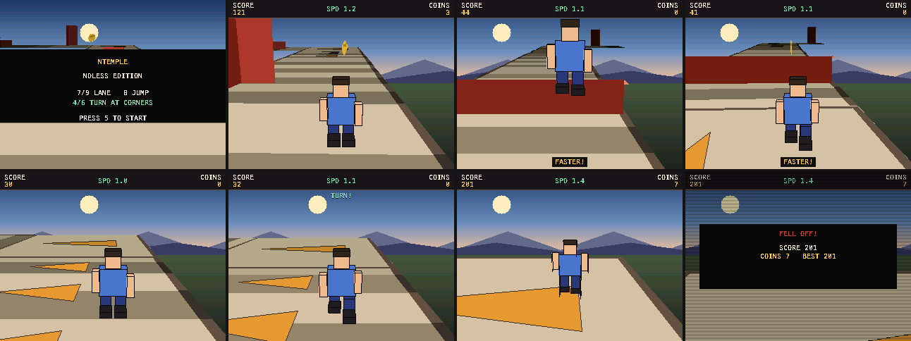
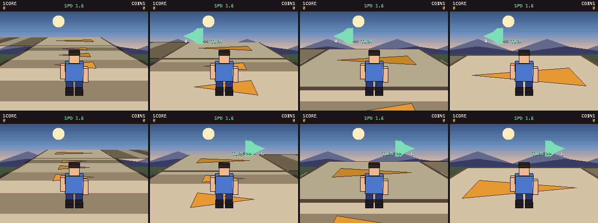
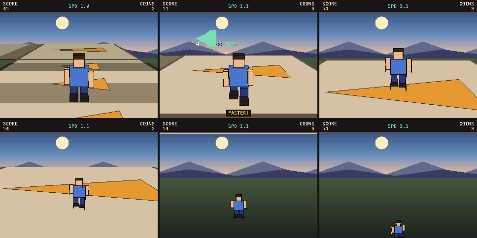

# nTemple — TI-Nspire / Ndless

**nTemple** —— 一个跑在 TI-Nspire（Ndless）上的「神庙逃亡」风格无尽跑酷：3 车道自动奔跑、跳跃躲障碍、吃金币、**90° 转角必须自己转**。



拐角方向与按键一致（地面箭头、屏幕提示、赛道实际弯向三者同源）。上排是**左弯**（提示 `4`，箭头指向左），下排是**右弯**（提示 `6`，箭头指向右），从左到右逐渐接近路口：



没转过来的话——



## 操作（计算器键盘）

| 按键 | 动作 |
| --- | --- |
| `7` / `←` | 向左变道 |
| `9` / `→` | 向右变道 |
| `8` / `↑` | 跳跃（越过矮墙、全宽石墙） |
| `5` | **开始 / 重开**（标题界面和结算界面） |
| `4` | **向左转**（弯在左边时按，屏幕会提示） |
| `6` | **向右转**（弯在右边时按） |
| `ESC` | 退出 |

滑铲已经去掉了，`5` 改成了开始/重开键。

## 玩法

- **每次开局的地图都不一样**：地形、障碍、金币全部由种子随机生成，种子取自开机时的噪声（文件时钟 + 屏幕残留像素），再混上「你在标题界面停留了几帧」，所以同一局重开也是新图。
- 分数 = 距离 / 90 + 金币 × 5。
- 速度随**距离**递增：900 → 2100 单位/秒（开局约 1 倍，跑满约 2.3 倍），HUD 中间的 `SPD 1.4` 就是当前倍率，每跳一档会在底部闪一次 `FASTER!`。
- **障碍密度随时间上升**：路是分成「槽位」生成的，槽位之间的间隔按**时间**缩短（开局 36 帧一个 → 后期 22 帧一个），而速度又在涨，所以世界坐标里的间距是变大的、玩家体感却是越来越密——这正是高速下还能玩的原因。
- 五种槽位内容，权重随难度变化：单障碍、**双车道封路**（只有一条能过）、**全宽石墙**（躲不掉，只能跳）、后期才出现的**蛇形三连**、以及空槽喘息。
- 两种单车道障碍：**红色立柱**必须换道；**矮墙**要跳。
- 金币是旋转的金色菱形，吃到 +5 分，偏向放在中间车道（跑者本来就在那儿）。
- 走廊每 `turn_window + 2400~4200` 单位拐一个 90° 弯。拐角是一块**石板广场**，地面上提前一段路画着三个**指向拐弯方向的橙色箭头**，屏幕中间同时闪 `TURN << 4` / `TURN >> 6`。
- **按键方向是从几何算出来的**（`corner_dir()` 比较新旧路段的朝向），所以提示箭头永远和赛道实际弯向一致：向左弯就是 `4`，向右弯就是 `6`。
- 过弯没按 / 按错不会「撞墙」了：人会沿着原方向冲出赛道边缘，镜头停在崖边看着他**掉进虚空**，然后结算（`FELL OFF!`）。
- 最高分存到程序同目录的 `ntemple.hi`。

## 技术实现

没有用 nQuake 的 BSP/渲染管线（那需要地图与 QuakeC），而是照着它的软件渲染思路，从零写了一套更轻量的 3D：

- **渲染距离**：5733 单位（原 4300 的三分之四），远处地板条带自动降采样成 2 倍步长，所以多边形数几乎没变（实测 +8%）。
- **渲染**：320×240 RGB565 自绘，透视投影 + 近平面裁剪（Sutherland–Hodgman）+ 凸多边形扫描线填充，画家算法排序（远→近），按距离做 8 级明暗雾化。
- **天空盒**：渐变天空 + 太阳 + 两层视差远山；赛道改成悬空石桥（只有地面 + 石质路沿），远处是深绿色丛林地面。
- **地图生成**（`populate_segment`）：整条路按「槽位」铺，槽位间隔用**帧数**计算再乘当前速度，于是难度上升时玩家可反应的时间单调变短。生成器遵守几条硬约束（由 `host/maptest.c` 逐条验证）：任意时刻三条车道至少有一条不是硬障碍；相邻两簇障碍在**帧**维度上留够换道时间；全宽墙后面强制补一段落地缓冲；两条全宽墙至少隔 3 秒；**拐角窗口内禁止生成任何障碍**（一边跳一边按转向键不是技术，是抽奖）。
- **几何**：按「赛道段」生成矩形地板——每段沿走向细分 150 单位的条带，**每段只画到自己的终点**；拐角处再补一块 2×半赛道宽的石板广场（带石缝边框），于是路口是干净的 L 形，而不是以前那种「十字重叠」的错乱拼法。路沿会避开拐角肘部，不会出现穿模的斜线。
- **镜头**：追尾机位——相机永远在跑者正后方 `CAM_BACK` 处，朝向按 `dir/2` 的速率平滑跟到当前路段；拐弯时镜头绕人旋转，不会切墙也不会看到贴脸墙面。
- **数学**：全整数/定点（16.16），sin/cos 查表（Q16），ARM926 上没有浮点也没有硬件除法的场合也能跑；扫描线填充用增量步进，内层循环没有除法。
- **角色**：几块方块拼的小人，**画在相机坐标系里**（永远背对镜头），所以拐弯时不会出现「侧身跑」；跑步摆腿/摆臂，跳跃时相机跟着抬。
- **手感**：跳跃重力 5200 单位/秒²、起跳 1900 单位/秒（滞空约 0.73s，跳高约 315 单位），落地后才能再跳。
- **掉落动画**：过弯失败时进入 `ST_FALL`，人保留前进惯性、重力加速下坠，镜头冻结在崖边并加大俯角，看着他掉出画面；结算面板写 `FELL OFF!`（撞障碍则是 `GAME OVER`）。
- **字体**：`tools/genfont.py` 用系统等宽字体烤出的 6×8 点阵（`font_data.h`），带阴影绘制。
- **预览器**：`host/preview.c` 用 `#include "game.c"` 把同一份游戏逻辑编成 macOS 程序，跑自动驾驶并导出 PPM/PNG 截图——所以上面这些图就是真实渲染结果。

## 文件

```
ntemple/
├── game.c        游戏本体（渲染 + 玩法，可移植）
├── game.h        API 与按键位定义
├── main.c        Nspire 入口（lcd_init / lcd_blit / isKeyPressed）
├── font_data.h   点阵字体（生成）
├── sin_table.h   正弦表（生成）
├── Makefile      nspire-gcc 构建 → ntemple.tns
├── tools/genfont.py    点阵字体生成
├── tools/shots.py      PPM→PNG + 拼图（只用标准库）
├── host/preview.c  macOS 预览/截图（自动驾驶 + 出图）
├── host/bot.h      自动驾驶机器人（预览与 soak 共用）
├── host/turntest.c 拐角方向诊断（左/右弯 × 4 个距离）
├── host/dirtest.c  不变量自检：每个弯的屏幕朝向 vs 要求按的键
├── host/maptest.c  地图生成器自检：300 个种子的可玩性不变量
├── host/soak.c     压力测试：机器人连玩 60 张图，看会不会死于不公平
├── host/falltest.c 掉落动画分镜
└── prev/         截图
```

## 构建

```sh
# 计算器版本（需要之前配好的 Ndless SDK）
cd ~/Desktop/code/ndless/ntemple
make                      # → ntemple.tns

# 电脑上预览 + 出图（自动跑自动驾驶、拐角诊断、掉落分镜，再转 PNG 拼图）
make preview              # → prev/*.png

# 自动自检：拐角方向不变量 + 300 张随机图的可玩性 + 机器人连玩 5 分钟
make check
```

把 `ntemple.tns` 传到计算器的 `ndless` 文件夹，打开即可（需要先装好 Ndless）。

## 已知限制

- 没有音效（Nspire 的声音 API 在 Ndless 上不是标准库级别）。
- 转角是「进入窗口按键」的 QTE，不是自由转向；操作手感更接近街机跑酷。
- 难度到顶（约 15 分钟后）就平了：速度 2100、槽位 22 帧不再变，之后纯粹比谁不失误。段表上限 4096 段，够连玩一个半小时。
- 帧率取决于机型（CX II > CX）；逻辑按帧推进，掉帧不会导致穿模，只会整体变慢。
